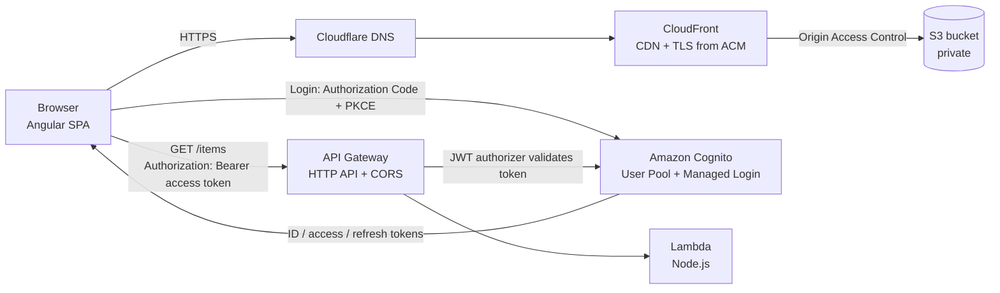
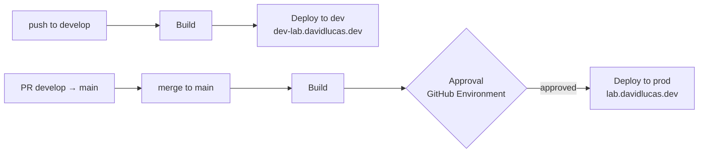

# AWS Lab — Angular on AWS

A production-style Angular SPA deployed on AWS with a custom domain, Amazon Cognito authentication, a serverless API protected by JWT, a keyless CI/CD pipeline with separate dev and prod environments, and infrastructure as code with AWS CDK.

| Environment | URL | Branch | Deploy | Infrastructure |
| --- | --- | --- | --- | --- |
| **prod** | https://lab.davidlucas.dev | `main` | Automatic after **manual approval** | Created in the console |
| **dev** | https://dev-lab.davidlucas.dev | `develop` | Automatic on every push | Created in the console |
| **qa** | CloudFront default domain | — | Manual upload | **AWS CDK** (`infra/`) |

---

## Architecture



Each environment has its own S3 bucket and CloudFront distribution. Prod and dev also use ACM certificates and custom subdomains. Cognito and the API are shared and allow both origins.

| Layer | Service | What it does |
| --- | --- | --- |
| Hosting | **Amazon S3** | Stores the Angular build output in a **private** bucket (Block Public Access on). |
| CDN | **Amazon CloudFront** | Serves the app over HTTPS from edge locations; the only reader of the bucket via **Origin Access Control (OAC)**. |
| TLS | **AWS Certificate Manager (ACM)** | Free, auto-renewing certificates issued in `us-east-1` (required by CloudFront) and validated through DNS. |
| DNS | **Cloudflare** | `CNAME` records for ACM validation and for routing each subdomain to its CloudFront distribution (DNS only, not proxied). |
| Auth | **Amazon Cognito** | User Pool with sign-up / sign-in, email verification and Managed Login pages. Public app client (no secret) using **Authorization Code + PKCE**. |
| API | **Amazon API Gateway (HTTP API)** | `GET /items` route with a **JWT authorizer** backed by Cognito and CORS restricted to the app origins. |
| Compute | **AWS Lambda** | Node.js function that returns data and reads the already-validated token claims. |
| CI/CD | **GitHub Actions + IAM OIDC** | Builds and deploys on push using short-lived credentials, with one IAM role per environment. |
| Access | **AWS IAM** | Root account with MFA and no access keys; daily work with an IAM admin user; least-privilege roles for the pipeline and Lambda. |

---

## Features

- **Static hosting on S3 + CloudFront** with a private bucket and OAC.
- **SPA routing on refresh:** CloudFront maps `403`/`404` to `/index.html` with a `200`, so deep links like `/perfil` work.
- **Cache strategy:** hashed assets are cached for one year (`immutable`); `index.html` is uploaded with `no-cache` and invalidated on every deploy.
- **HTTPS everywhere:** HTTP is redirected to HTTPS at the CloudFront behavior.
- **Authentication with Cognito:** login, logout (local + Cognito session) and user data from the ID token.
- **Protected routes:** `/privado` uses a guard that redirects to Cognito Managed Login when there is no session.
- **HTTP interceptor:** attaches the access token only to requests that target the API (`secureRoutes`), never to third-party URLs.
- **Serverless API:** API Gateway rejects missing or invalid tokens with `401` before Lambda runs.
- **Keyless CI/CD:** GitHub Actions assumes an IAM role through OIDC; no AWS access keys are stored anywhere.
- **Dev and prod environments:** `develop` deploys to dev automatically; `main` deploys to prod after GitHub Environment approval is configured.
- **Rollback:** a manual workflow run can redeploy a previous tag or commit.
- **Automatic release tags:** every successful prod deploy creates the next semantic version tag (`v1.0.2`, `v1.0.3`, …).
- **Infrastructure as code:** the QA hosting layer (S3 + CloudFront + OAC) is defined in AWS CDK and parameterized by environment.
- **Modern Angular:** standalone components, signals and `computed` for session state, new control flow (`@if`, `@for`), zoneless change detection.

---

## Tech stack

- **Front end:** Angular, TypeScript, SCSS, [`angular-auth-oidc-client`](https://github.com/damienbod/angular-auth-oidc-client)
- **AWS:** S3, CloudFront, ACM, Cognito, API Gateway (HTTP API), Lambda (Node.js), IAM, STS, CloudTrail, CloudWatch Logs
- **CI/CD:** GitHub Actions, GitHub Environments
- **Infrastructure as code:** AWS CDK (TypeScript), AWS CloudFormation
- **DNS:** Cloudflare
- **Tooling:** Angular CLI, AWS CLI v2

---

## Project structure

```
.github/
└── workflows/
    └── deploy.yml           # Build + deploy to dev or prod, rollback, release tags
infra/                       # AWS CDK app (own package.json)
├── bin/infra.ts             # Entry point: one stack per environment
└── lib/infra-stack.ts       # Hosting stack: private S3 bucket + CloudFront + OAC
src/
├── app/
│   ├── app.config.ts        # Router, HttpClient + auth interceptor, OIDC config
│   ├── app.routes.ts        # Routes; /privado protected by autoLoginPartialRoutesGuard
│   ├── app.ts / app.html    # Top bar, login / logout, session state with signals
│   └── pages/
│       ├── home/            # Overview of the lab
│       ├── perfil/          # User data from the ID token
│       └── privado/         # Calls the protected API
└── styles.scss              # Shared design tokens and components
```

---

## Running locally

Requirements: Node.js 20+ and the Angular CLI.

```bash
npm install
ng serve
```

Open http://localhost:4200. `http://localhost:4200` is registered in Cognito as an allowed callback and sign-out URL, and in the API CORS configuration.

---

## CI/CD



The workflow ([`.github/workflows/deploy.yml`](.github/workflows/deploy.yml)) runs on every push to `develop` or `main` and picks the environment from the branch:

| | dev | prod |
| --- | --- | --- |
| Branch allowed to deploy | `develop` | `main` |
| Approval | None | Configure a required reviewer in the GitHub `prod` environment |
| IAM role | `github-actions-aws-lab-dev` | `github-actions-aws-lab-deploy` |
| Variables | Its own bucket, distribution and role ARN | Its own bucket, distribution and role ARN |

**Pipeline steps:** checkout → `npm ci` → `ng build` → assume the IAM role with OIDC → upload hashed assets with long-lived caching → upload `index.html` with `no-cache` → invalidate `/index.html` in CloudFront. Successful prod deploys also create a release tag.

Only `index.html` is invalidated: every other file has a content hash in its name, so a new build produces new file names.

### Authentication with OIDC

GitHub Actions requests a signed OIDC token and exchanges it with AWS STS for temporary credentials (valid for one hour). Each role's trust policy should only accept tokens from this repository **and** its environment:

```json
"Condition": {
  "StringEquals": {
    "token.actions.githubusercontent.com:aud": "sts.amazonaws.com",
    "token.actions.githubusercontent.com:sub": "repo:<owner>@<owner-id>/aws-lab@<repo-id>:environment:prod"
  }
}
```

The `sub` claim includes the immutable owner and repository IDs, so a renamed or re-created repository with the same name cannot assume the role. Each role can only write to its own bucket and invalidate its own distribution.

### Rollback

Every stable prod release is tagged (`v1.0.0`, `v1.0.1`, …). To roll back:

1. **Actions → Deploy to AWS → Run workflow**, from the `main` branch.
2. Enter the tag or commit SHA to deploy (for example `v1.0.0`).
3. Approve the prod deployment if the `prod` GitHub Environment has required reviewers.
4. Fix forward in the code with `git revert` and a new PR, so `main` matches what is running in production.

The deployment history (**Deployments → prod**) records every deploy with its commit, approver and timestamp.

### Release tags

After a successful prod deploy, the workflow finds the highest `v*` tag, bumps the patch number and pushes the new tag. Manual runs with a `ref` do not create tags, because they redeploy a version that is already tagged.

### Manual deployment (reference)

```bash
ng build
aws s3 sync dist/aws-lab/browser s3://<bucket-name> \
  --delete --exclude index.html \
  --cache-control "public,max-age=31536000,immutable"
aws s3 cp dist/aws-lab/browser/index.html s3://<bucket-name>/index.html \
  --cache-control "no-cache"
aws cloudfront create-invalidation --distribution-id <distribution-id> --paths "/index.html"
```

---

## Infrastructure as code (AWS CDK)

The `infra/` folder is an AWS CDK app in TypeScript. One reusable stack defines the hosting layer, and each environment is a single line:

```typescript
new InfraStack(app, 'AwsLab-Qa-Hosting', { env, envName: 'qa' });
```

The current entry point deploys the QA stack. Dev and prod are commented examples and are still managed in the AWS console.

The stack creates:

| Resource | Configuration |
| --- | --- |
| S3 bucket | Block Public Access, S3-managed encryption, HTTPS-only bucket policy (`enforceSSL`) |
| Origin Access Control | Only this distribution can read the bucket |
| CloudFront distribution | `index.html` root object, HTTP → HTTPS, `CachingOptimized`, compression, managed **security headers** policy |
| Error responses | `403`/`404` → `/index.html` with `200` for Angular routing |
| Outputs | Bucket name, distribution ID and domain, used by the deploy step |

```bash
cd infra
npm install
cdk synth     # generate the CloudFormation template
cdk diff      # preview changes, including IAM/security changes
cdk deploy    # create or update the stack
cdk destroy   # delete the environment
```

The account and region were bootstrapped once with `cdk bootstrap aws://<account-id>/us-east-1`.

Infrastructure and application are deployed separately: CDK creates the empty hosting stack, and the build is uploaded afterwards with `aws s3 sync` (or the pipeline).

**Migration plan.** Dev and prod were built in the console first. Instead of importing them into CDK, each one will be recreated as a new CDK stack, switched over (DNS, certificate, pipeline variables and IAM permissions) and only then the manual resources removed: QA first, then dev, then prod.

---

## Technical decisions

**Private bucket + OAC instead of S3 static website hosting.** The bucket is never public; CloudFront is the single entry point for HTTPS, caching and security headers.

**Certificates in `us-east-1`.** CloudFront only accepts ACM certificates from that region.

**Cloudflare in DNS-only mode.** Proxying through Cloudflare would put a second CDN in front of CloudFront and break TLS. The ACM validation records stay in place so the certificates renew automatically.

**Authorization Code + PKCE, no client secret.** Anything shipped to the browser is public, so the SPA uses a public client; PKCE protects the code exchange.

**Access token to the API, ID token for the UI.** The access token is what the API authorizes against; the ID token is used only to show user details such as the email.

**Authorization at the gateway.** API Gateway validates signature, issuer, expiry and audience (`client_id`). Invalid requests never reach Lambda, so they cost nothing and the function only receives trusted claims.

**CORS limited to known origins.** Only `http://localhost:4200`, `https://dev-lab.davidlucas.dev` and `https://lab.davidlucas.dev` may call the API, with the `authorization` and `content-type` headers.

**OIDC instead of access keys in CI.** No long-lived credentials to leak or rotate; access is scoped per environment through the token's `sub` claim.

**One IAM role per environment.** The dev role cannot touch prod resources, even if the workflow file is modified, because it is only trusted for `environment:dev`.

**Approval gate on prod.** GitHub Environment protection rules can require approval for every production deployment.

**One parameterized CDK stack for every environment.** Environments differ only in their name, so they cannot drift apart, and a new one is created with one line instead of repeating console steps.

**Migrate to CDK by recreating, not importing.** Rebuilding each environment as a new stack and switching traffic over is safer than `cdk import` for CloudFront, OAC and bucket policies, and production is never touched until the process is proven on lower environments.

**Shared Cognito and API across environments.** Acceptable for a lab; in a real project dev would have its own User Pool and API to keep test users and data out of production.

---

## Troubleshooting notes

Real issues found while building the lab and how they were diagnosed:

| Symptom | Cause | Fix |
| --- | --- | --- |
| IAM user gets `AccessDenied` everywhere | User created without any policy (implicit deny) | Attach the required permissions |
| Certificate not listed in CloudFront | Requested outside `us-east-1` | Request it in `us-east-1` |
| API returns `401 invalid audience` | Leading spaces in the authorizer's audience | Paste the exact app client ID |
| `Not authorized to perform sts:AssumeRoleWithWebIdentity` | Trust policy used the old `sub` format; GitHub now includes owner and repo IDs | Read the real `sub` in **CloudTrail** and match it exactly |
| Prod deploy ran without approval | The GitHub `prod` environment has no required reviewer rule | Configure a required reviewer in environment protection rules |

---

## Security notes

- Root user protected with MFA and without access keys.
- Day-to-day work with an IAM user; AWS CLI authenticated with temporary credentials (`aws login`).
- CI/CD uses OIDC and least-privilege roles scoped to one repository, one environment, one bucket and one distribution.
- No secrets in this repository: the Cognito client ID, user pool ID and API URL are public by design in a SPA.
- Budget alert configured to track credit and cost usage.

---

## Roadmap

- [x] CI/CD with GitHub Actions using **OIDC** (no long-lived AWS keys) and least-privilege IAM roles
- [x] Separate dev and prod environments with a required approval for prod
- [x] Rollback by redeploying a previous tag or commit
- [x] Automatic release tag after each successful prod deploy
- [x] Hosting stack in AWS CDK (qa environment), with security headers
- [ ] Custom domain and certificate for qa in CDK
- [ ] Migrate dev and prod to CDK
- [ ] Lambda versions and aliases for instant API rollback
- [ ] DynamoDB table behind the Lambda for persistent data
- [ ] CloudWatch alarm on API and Lambda errors

---

## Author

**David Lucas Bautista** — Senior Software Engineer  
[davidlucas.dev](https://davidlucas.dev) · [LinkedIn](https://linkedin.com/in/david-lb)
