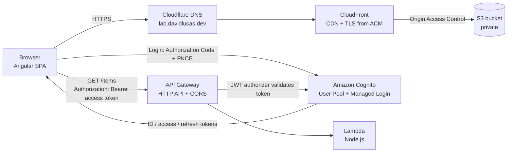

# AWS Lab — Angular on AWS

A production-style Angular SPA deployed on AWS with a custom domain, Amazon Cognito authentication, and a serverless API protected by JWT.

**Live demo:** https://lab.davidlucas.dev

---

## Architecture



| Layer | Service | What it does |
| --- | --- | --- |
| Hosting | **Amazon S3** | Stores the Angular build output in a **private** bucket (Block Public Access on). |
| CDN | **Amazon CloudFront** | Serves the app over HTTPS from edge locations; the only reader of the bucket via **Origin Access Control (OAC)**. |
| TLS | **AWS Certificate Manager (ACM)** | Free, auto-renewing certificate for `lab.davidlucas.dev`, issued in `us-east-1` (required by CloudFront) and validated through DNS. |
| DNS | **Cloudflare** | `CNAME` records for ACM validation and for routing the subdomain to CloudFront (DNS only, not proxied). |
| Auth | **Amazon Cognito** | User Pool with sign-up / sign-in, email verification and Managed Login pages. Public app client (no secret) using **Authorization Code + PKCE**. |
| API | **Amazon API Gateway (HTTP API)** | `GET /items` route with a **JWT authorizer** backed by Cognito and CORS restricted to the app origins. |
| Compute | **AWS Lambda** | Node.js function that returns data and reads the already-validated token claims. |
| Access | **AWS IAM** | Root account with MFA and no access keys; daily work with an IAM admin user; Lambda execution role limited to CloudWatch Logs. |

---

## Features

- **Static hosting on S3 + CloudFront** with a private bucket and OAC.
- **SPA routing on refresh:** CloudFront maps `403`/`404` to `/index.html` with a `200`, so deep links like `/perfil` work.
- **Cache strategy:** hashed assets are cached for one year (`immutable`); `index.html` is uploaded with `no-cache` and invalidated on every deploy.
- **HTTPS everywhere:** HTTP is redirected to HTTPS at the CloudFront behavior.
- **Authentication with Cognito:** login, logout (local + Cognito session) and user data from the ID token.
- **Protected routes:** `/privado` uses a guard that redirects to Cognito Managed Login when there is no session.
- **HTTP interceptor:** attaches the access token only to requests that target the API (`secureRoutes`), never to third-party URLs.
- **Serverless API:** API Gateway rejects missing or invalid tokens with `401` before Lambda runs.
- **Modern Angular:** standalone components, signals and `computed` for session state, new control flow (`@if`, `@for`), zoneless change detection.

---

## Tech stack

- **Front end:** Angular, TypeScript, SCSS, [`angular-auth-oidc-client`](https://github.com/damienbod/angular-auth-oidc-client)
- **AWS:** S3, CloudFront, ACM, Cognito, API Gateway (HTTP API), Lambda (Node.js), IAM, CloudWatch Logs
- **DNS:** Cloudflare
- **Tooling:** Angular CLI, AWS CLI v2

---

## Project structure

```
src/
├── app/
│   ├── app.config.ts        # Router, HttpClient + auth interceptor, OIDC config
│   ├── app.routes.ts        # Routes; /privado protected by autoLoginPartialRoutesGuard
│   ├── app.ts / app.html    # Top bar, login / logout, session state with signals
│   └── pages/
│       ├── home/            # Overview of the lab
│       ├── perfil/          # User data from the ID token
│       └── privado/         # Calls the protected API
└── styles.scss              # Shared design tokens and components
```

---

## Running locally

Requirements: Node.js 20+ and the Angular CLI.

```bash
npm install
ng serve
```

Open http://localhost:4200. `http://localhost:4200` is registered in Cognito as an allowed callback and sign-out URL, and in the API CORS configuration.

---

## Deployment

```bash
# 1. Build
ng build

# 2. Upload hashed assets with long-lived caching
aws s3 sync dist/aws-lab/browser s3://<bucket-name> \
  --delete --exclude index.html \
  --cache-control "public,max-age=31536000,immutable"

# 3. Upload index.html without caching
aws s3 cp dist/aws-lab/browser/index.html s3://<bucket-name>/index.html \
  --cache-control "no-cache"

# 4. Invalidate index.html in CloudFront
aws cloudfront create-invalidation --distribution-id <distribution-id> --paths "/index.html"
```

Only `index.html` is invalidated: every other file has a content hash in its name, so a new build produces new file names.

---

## Technical decisions

**Private bucket + OAC instead of S3 static website hosting.** The bucket is never public; CloudFront is the single entry point for HTTPS, caching and security headers.

**Certificate in `us-east-1`.** CloudFront only accepts ACM certificates from that region.

**Cloudflare in DNS-only mode.** Proxying through Cloudflare would put a second CDN in front of CloudFront and break TLS. The ACM validation record stays in place so the certificate renews automatically.

**Authorization Code + PKCE, no client secret.** Anything shipped to the browser is public, so the SPA uses a public client; PKCE protects the code exchange.

**Access token to the API, ID token for the UI.** The access token is what the API authorizes against; the ID token is used only to show user details such as the email.

**Authorization at the gateway.** API Gateway validates signature, issuer, expiry and audience (`client_id`). Invalid requests never reach Lambda, so they cost nothing and the function only receives trusted claims.

**CORS limited to known origins.** Only `http://localhost:4200` and `https://lab.davidlucas.dev` may call the API, with the `authorization` and `content-type` headers.

---

## Security notes

- Root user protected with MFA and without access keys.
- Day-to-day work with an IAM user; AWS CLI authenticated with temporary credentials (`aws login`).
- No secrets in this repository: the Cognito client ID, user pool ID and API URL are public by design in a SPA.
- Budget alert configured to track credit and cost usage.

---

## Roadmap

- [ ] CI/CD with GitHub Actions using **OIDC** (no long-lived AWS keys) and a least-privilege IAM role
- [ ] CloudFront response headers policy for security headers (HSTS, X-Frame-Options, etc.)
- [ ] DynamoDB table behind the Lambda for persistent data
- [ ] Infrastructure as code with AWS CDK (TypeScript)
- [ ] CloudWatch alarm on API and Lambda errors

---

## Author

**David Lucas Bautista** — Senior Software Engineer  
[davidlucas.dev](https://davidlucas.dev) · [LinkedIn](https://linkedin.com/in/david-lb)
